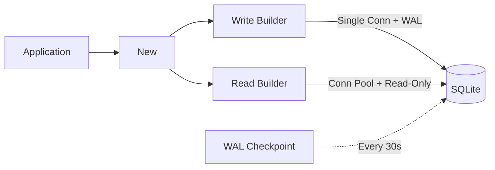

> [!NOTE]
> This README was generated by [SKILL](https://github.com/pardnchiu/skill-readme-generate), get the ZH version from [here](./README.zh.md).

# go-sqlite

[](https://pkg.go.dev/github.com/pardnchiu/go-sqlite)
[](https://goreportcard.com/report/github.com/pardnchiu/go-sqlite)
[](LICENSE)
[](https://github.com/pardnchiu/go-sqlite/releases)

> A Go SQLite library built on read-write separation architecture, simplifying database access through a chainable API and automatic struct binding

## Table of Contents

- [Features](#features)
- [Architecture](#architecture)
- [File Structure](#file-structure)
- [License](#license)
- [Author](#author)
- [Stars](#stars)

## Features

> `go get github.com/pardnchiu/go-sqlite` · [Documentation](./doc.md)

### Read-Write Separated Connection Pool

Initialization automatically creates dedicated read and write connections. The write side is restricted to a single connection with WAL mode and immediate transaction locks, preventing write conflicts at the root. The read side exposes a configurable connection pool, maintaining stable query throughput under high concurrency. A background goroutine periodically performs WAL checkpoints to prevent unbounded database file growth.

### Chainable Query Builder

All query operations are chained through the Builder pattern, supporting Where, OrWhere, Having, Join, GroupBy, OrderBy, Limit, Offset and other complete SQL clauses. All column and table names undergo regex validation and SQL reserved word checks. Parameters are always bound via prepared statements, blocking SQL injection at the syntax level.

### Automatic Struct Binding

Query results can be mapped directly to Go structs or slices via the `Bind()` method, using `db` tags for column name matching. Passing a struct pointer automatically appends `LIMIT 1`, while passing a slice pointer scans all result rows. Developers no longer need to manually handle `rows.Scan` and column mapping logic.

## Architecture



## File Structure

```
go-sqlite/
├── instance.go              # Entry point, creates read-write connections
├── core/
│   ├── interface.go         # Type definitions (Config, Builder, Connector)
│   ├── builder.go           # Builder core: Create, Delete, Raw
│   ├── connector.go         # Connector: Query, Exec, Close
│   ├── select.go            # SELECT queries and Bind mapping
│   ├── select_ext.go        # First, Last, Count
│   ├── select_where.go      # Where clause methods
│   ├── select_or_where.go   # OrWhere clause methods
│   ├── select_having.go     # Having clause methods
│   ├── select_or_having.go  # OrHaving clause methods
│   ├── insert.go            # Insert, InsertBatch, Conflict
│   ├── update.go            # Update, Increase, Decrease, Toggle
│   └── utils.go             # Column validation and SQL keyword checks
├── go.mod
└── LICENSE
```

## License

This project is licensed under the [MIT LICENSE](LICENSE).

## Author


<h4 style="padding-top: 0">邱敬幃 Pardn Chiu</h4>

<a href="mailto:dev@pardn.io" target="_blank">

</a> <a href="https://linkedin.com/in/pardnchiu" target="_blank">

</a>

## Stars

[](https://www.star-history.com/#pardnchiu/go-sqlite&Date)

***

©️ 2026 [邱敬幃 Pardn Chiu](https://linkedin.com/in/pardnchiu)
