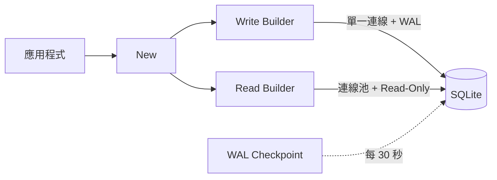

> [!NOTE]
> 此 README 由 [SKILL](https://github.com/pardnchiu/skill-readme-generate) 生成，英文版請參閱 [這裡](./README.md)。

# go-sqlite

[](https://pkg.go.dev/github.com/pardnchiu/go-sqlite)
[](https://goreportcard.com/report/github.com/pardnchiu/go-sqlite)
[](LICENSE)
[](https://github.com/pardnchiu/go-sqlite/releases)

> 基於讀寫分離架構的 Go SQLite 操作套件，透過鏈式 API 與自動 Struct 綁定簡化資料庫存取

## 目錄

- [功能特點](#功能特點)
- [架構](#架構)
- [檔案結構](#檔案結構)
- [授權](#授權)
- [Author](#author)
- [Stars](#stars)

## 功能特點

> `go get github.com/pardnchiu/go-sqlite` · [完整文件](./doc.zh.md)

### 讀寫分離連線池

初始化時自動建立獨立的讀取與寫入連線，寫入端限制為單一連線搭配 WAL 模式與 immediate transaction lock，從根本避免寫入衝突。讀取端則開放可配置的連線池，在高併發場景下維持穩定的查詢吞吐量。背景 goroutine 定期執行 WAL checkpoint，確保資料庫檔案不會無限膨脹。

### 鏈式查詢建構器

所有查詢操作透過 Builder 模式串接，支援 Where、OrWhere、Having、Join、GroupBy、OrderBy、Limit、Offset 等完整 SQL 子句。所有欄位名稱與表名經過正規表達式驗證與 SQL 保留字檢查，參數一律使用 prepared statement 綁定，在語法層面阻擋 SQL Injection。

### 自動 Struct 綁定

查詢結果可透過 `Bind()` 方法直接映射至 Go struct 或 slice，利用 `db` tag 對應欄位名稱。傳入 struct pointer 時自動加上 `LIMIT 1`，傳入 slice pointer 時掃描全部結果列，開發者無需手動處理 `rows.Scan` 與欄位對應邏輯。

## 架構



## 檔案結構

```
go-sqlite/
├── instance.go              # 進入點，建立讀寫分離連線
├── core/
│   ├── interface.go         # 型別定義（Config, Builder, Connector）
│   ├── builder.go           # Builder 核心：Create, Delete, Raw
│   ├── connector.go         # Connector：Query, Exec, Close
│   ├── select.go            # SELECT 查詢與 Bind 綁定
│   ├── select_ext.go        # First, Last, Count
│   ├── select_where.go      # Where 系列條件
│   ├── select_or_where.go   # OrWhere 系列條件
│   ├── select_having.go     # Having 系列條件
│   ├── select_or_having.go  # OrHaving 系列條件
│   ├── insert.go            # Insert, InsertBatch, Conflict
│   ├── update.go            # Update, Increase, Decrease, Toggle
│   └── utils.go             # 欄位驗證與 SQL 保留字檢查
├── go.mod
└── LICENSE
```

## 授權

本專案採用 [MIT LICENSE](LICENSE)。

## Author


<h4 style="padding-top: 0">邱敬幃 Pardn Chiu</h4>

<a href="mailto:dev@pardn.io" target="_blank">

</a> <a href="https://linkedin.com/in/pardnchiu" target="_blank">

</a>

## Stars

[](https://www.star-history.com/#pardnchiu/go-sqlite&Date)

***

©️ 2026 [邱敬幃 Pardn Chiu](https://linkedin.com/in/pardnchiu)
